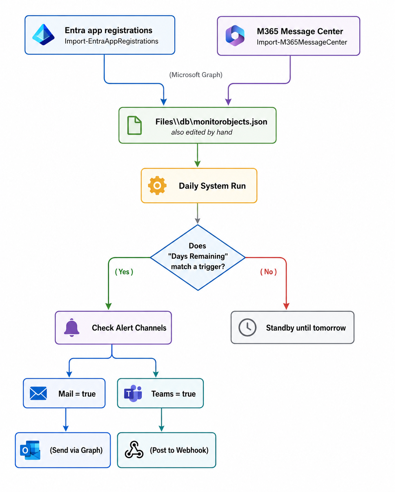
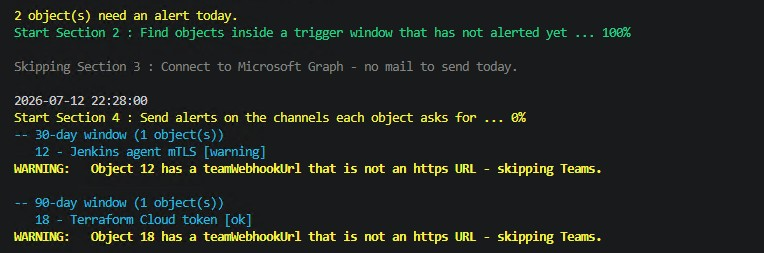
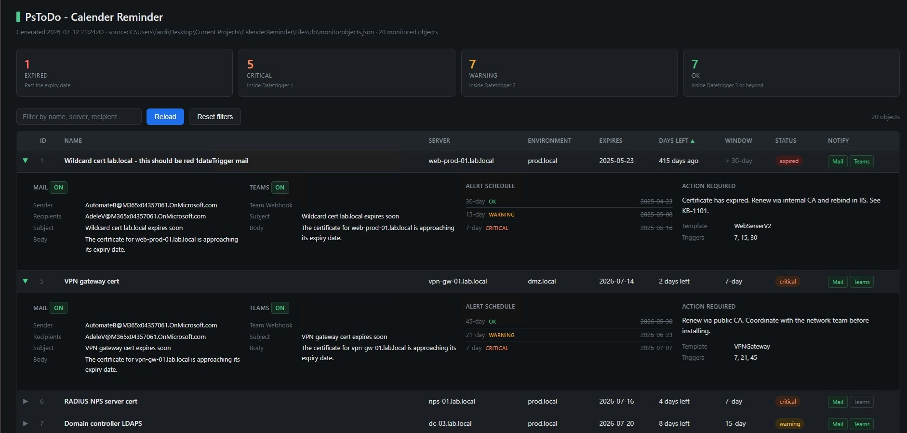
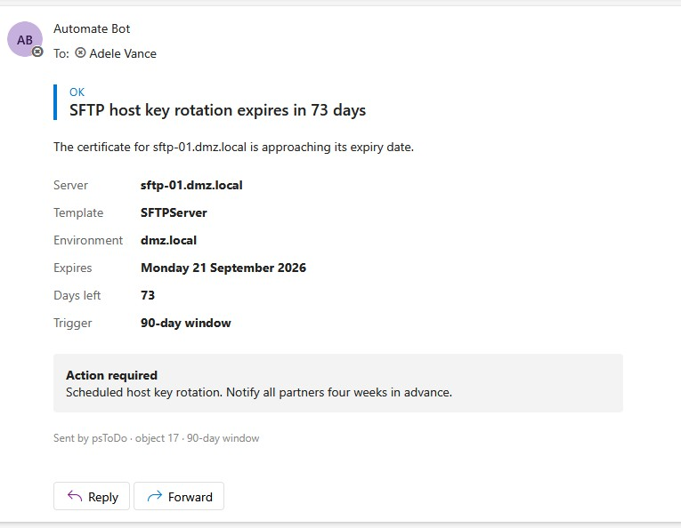
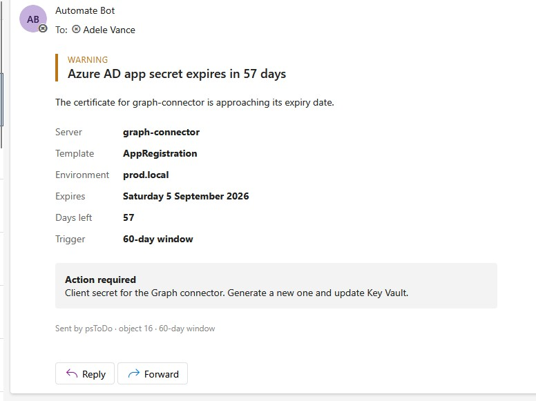
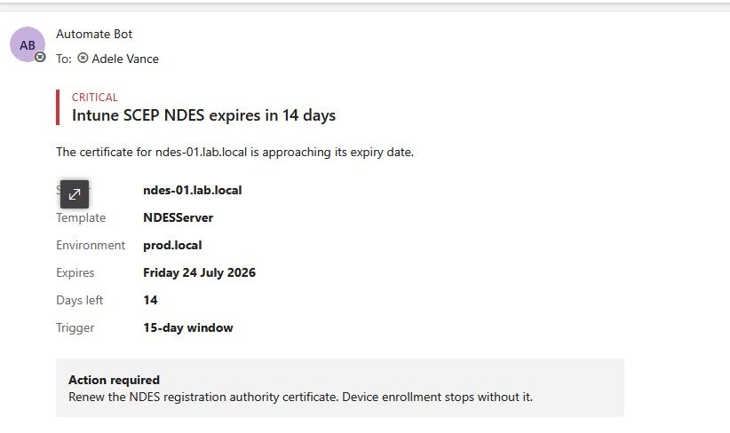
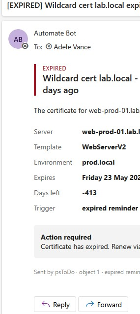

# psToDo — Calendar Reminder


A PowerShell solution that watches expiry dates in a JSON file and alerts a team by **mail** and **Microsoft Teams** before things lapse — certificates, secrets, tokens, host keys, license deadlines, or anything else with a deadline. It also renders a self-contained **HTML status dashboard** for IIS from the same data.

Built and tested on **PowerShell 7.3.1 (Core)**. The scripts avoid PowerShell 7-only syntax and are written to run on Windows PowerShell 5.1 as well.

---

## Table of Contents
- [What's new](#whats-new)
- [Components](#components)
- [Requirements](#requirements)
- [HTML dashboard](#html-dashboard)
- [Editing in the browser (edit.html)](#editing-in-the-browser-edithtml)
- [Publish with Entra application proxy and MFA](#publish-with-entra-application-proxy-and-mfa)
- [App registration & Graph permissions](#app-registration--graph-permissions)
- [How alerting works](#how-alerting-works)
- [Adding an object to monitor](#adding-an-object-to-monitor)
- [Object field reference](#object-field-reference)
- [State file & completed archive](#state-file--completed-archive)
- [Plugins (importers)](#plugins-importers)
- [Repository layout](#repository-layout)
- [Roadmap](#roadmap)

---

## What's new

### 1.5
- **New dashboard design (`index.html`)** — menu on the left (Overview, Objects, Completed, and Edit for editors), a header with your **organisation name and logo** and key facts (objects, next alert, last alerted, report updated), view tabs with what needs fixing on the right. Light theme by default (dark when Windows is dark); the moon/sun button switches between light and dark and the browser remembers it.
- **Overview page** — urgency cards, the 90-day timeline, **Upcoming alerts** (next alert per object: date, window, channel) and **Recent alerts** (what the alert script has sent).
- The **Edit** button is only shown to members of the editors group: `index.html` asks `psToDo-api.ashx?action=whoami` (new, read-only, returns no data). Viewers, and sites without the editor, see no Edit button.
- **The editor opens inside the dashboard** (Edit in the menu, the Edit tab or the pencil top right) instead of as a separate page; *Edit* on an object opens the editor at that object. Unsaved changes are kept while you switch views. `edit.html` still works on its own, and is now light by default with the same dark-theme button.
- **Next alert** and **Last alerted** columns, read from `Files\state\sent-state.json` with the same rules as the alert script. Each object's **alert schedule** shows every window as *Sent ✓ (time)*, *Due – goes out on the next run*, *Pending – opens (date)* or *Not sent*.
- **Timeline** of everything that expires in the next 90 days (hover for details, click to open the object). The **days box** in its header has a dropdown with 30 / 60 / 90 / 180 / 365 days, or you type your own number (1–3650) and press Enter; slide switches under the chart show or hide **Expired**, **Critical**, **Warning** and **OK** (expired objects get their own lane left of *Today*); the arrow hides the timeline. The browser remembers all of it.
- **Stale-report warning** when the page is older than 24 hours — the scheduled report run has stopped.
- **Export to CSV** (the rows you see, opens in Excel) and a **print view**.
- Optional **`owner`** field per object, shown in the table, in the details and in `edit.html`.
- Cleaner table: fixed column widths, right-aligned numbers, cards say *Within 7 days* instead of *Inside Datetrigger 1*.
- **Teams webhook URLs are shortened** in `index.html` (host + last four characters). The full address is only in `edit.html`.
- The local path of `monitorobjects.json` is no longer shown in the page. "Calender" is spelled "Calendar".
- The page is built from `Settings\Web\report-template.html`; settings live in `Settings\Config\ReportSettings.json`.
- New README section **[Publish with Entra application proxy and MFA](#publish-with-entra-application-proxy-and-mfa)**: Entra sign-in + MFA in front of the site, viewers and editors as AD groups, step by step.

### 1.4
- Beta onprem version : psToDo\BETA-Onprem Exchange
- **Editable dashboard (`edit.html`)** — the browser editor from the on-prem edition, now with **Teams** support: change objects, triggers, status, mail and Teams settings (including the webhook URL), add, duplicate and delete objects, and save straight back to `monitorobjects.json`. Only members of an AD editors group can save; everyone else who can open the site gets a read-only view. Every save is version-checked, backed up and logged. See [Editing in the browser](#editing-in-the-browser-edithtml).
- **IIS setup scripts** — `Install-help\Setup-IisReportSecurity.ps1` (Windows sign-in + IIS URL Authorization: only an AD group can open the site) and `Install-help\Setup-IisReportEditor.ps1` (turns on saving). A commented `Files\report\web.config` ships with the repo.
- **Fixes**
  - The Entra importers no longer crash on the second run (`Cannot convert null to type "System.DateTime"`) when an app without credentials has already been imported.
  - Scripts work when run with F8 / "Run Selection" (empty `$PSScriptRoot`): they fall back to the script path, then the current folder.
  - The HTML report's log file name no longer contains `/` (it created nested folders under `Logs`).
  - Windows PowerShell 5.1 compatibility: no `-AsArray`, `??` or other PowerShell 7-only syntax, JSON arrays are read and written the 5.1-safe way, and every `.ps1` is saved as UTF-8 with BOM.
  - The IIS example in this README (`system.web/authorization`) did not protect the static dashboard. It is replaced by IIS URL Authorization and the setup scripts.

### 1.3
- **Kanban mode** deployed.
- **Report split into five tabs**: **Monitored**, **Completed**, **No channel**, **No credentials**, **Not monitored**.
- **Completed archive** — objects with status `Completed` are **copied** (not moved) to `Files\config\MonitorObjectComplete.json` on every report run; the **Completed** tab is built only from that file.
- **No channel** tab — objects with neither mail nor Teams enabled, so they would never alert.
- App registrations with **no secret and no certificate** are imported and listed in the **No credentials** tab.
- Entra rows set `environment` to `Entra - <tenant name> - <tenant id>`; row detail shows **App ID** (Entra) or **Message ID** (Message Center).
- Added two **delegated importers** that sign in as a user (interactive) — no certificate or `MsGraphSettings.json` needed.

### 1.2
- HTML report gained a **Status** column (Backlog / Active / Completed) with coloured badges.
- Message Center rows carry a **severity** badge and a clickable **admin-center link**.

### 1.1
- Added the `Settings\plugin` importers for Entra app registrations and Microsoft 365 Message Center, each shipping as a versioned script with its own `config\version.json`.

---

## System design


---

## Components

| Script | Job |
|--------|-----|
| `psToDo-v1.3.ps1` | Reads `db\monitorobjects.json`, decides what is due, and sends the alerts based on each object's configuration. |
| `psToDo-HTML-Report-v1.3.ps1` | Reads `db\monitorobjects.json` and writes an HTML status page. |
| `psToDo-HTML-Report-Editable-v1.3.ps1` | Writes `edit.html`: the same data as an editable page. Saves go through `Settings\Web\psToDo-api.ashx`. |



---

## Requirements

| Requirement | Detail |
|-------------|--------|
| PowerShell | **7.3.1 or later (Core)**; written to also run on Windows PowerShell 5.1 |
| OS | Windows + Task Scheduler |
| IIS | Only for the dashboards. Windows Authentication + URL Authorization and an AD group (`Install-help\Setup-IisReportSecurity.ps1`); ASP.NET 4.x only for saving from `edit.html` (`Install-help\Setup-IisReportEditor.ps1`) |
| Modules | `Microsoft.Graph.Authentication`; the importers also use `Microsoft.Graph.Applications`, `Microsoft.Graph.Devices.ServiceAnnouncement` and `Microsoft.Graph.Identity.DirectoryManagement` (installed automatically on first run) |
| App reg | Mail needs Graph + a certificate. Teams needs only a webhook URL. |

---

## HTML dashboard

The dashboard opens on **Overview**: key facts in the header, one card per urgency (click to see those objects), a timeline of everything that expires in the next 90 days (hover for details, click to open the object; pick or type the number of days in the days box, or hide it with the arrow in its header – your browser remembers the choice), **Upcoming alerts** and **Recent alerts**. The **Monitored** tab is the object table. It shows each object's expiry **urgency** (expired / critical / warning / ok) and its manual **Status** (Backlog / Active / Completed) as badges with a symbol and a colour, plus **Next alert** (date, window and channel) and **Last alerted**, both read from `Files\state\sent-state.json`. Clicking a row opens its details: owner and object data, the alert schedule (sent ✓ / due / pending per window) and the mail and Teams settings. Message Center rows also show a **severity** badge and an **"Open in admin center"** link.

The buttons at the top right **export the rows you see to CSV** (UTF-8; `;` as separator when Windows uses a decimal comma, so Excel opens it directly) and **print** (a light, compact layout). Members of the editors group also get **Edit** (top right, in the menu and as a tab), which opens the editor (`edit.html`) inside the dashboard; *Edit* in an object's details jumps straight to that object. The page asks `psToDo-api.ashx?action=whoami` whether you may edit, so viewers never see it. The page follows the light/dark setting of Windows until you press the moon/sun button; that choice is remembered in the browser and also applies to the editor. If the page is older than `StaleAfterHours` (24 h), a red banner says that the scheduled report run has probably stopped.

Teams webhook URLs are **shortened** in `index.html` (`https://host/…abcd`): anyone who has a webhook URL can post to that channel, and the dashboard is often open to more people than the editors. The full URL is shown in `edit.html` only.

**`Settings\Config\ReportSettings.json`:**

```json
{
    "OrganizationName": "CONTOSO",
    "LogoPath": "Settings\\Config\\logo.png",
    "StaleAfterHours": 24,
    "TimelineDays": 90,
    "EditorUrl": ""
}
```

| Setting | What it does |
|---------|--------------|
| `OrganizationName` | Shown in the header, the breadcrumb and the browser tab. Empty = "psToDo". |
| `LogoPath` | PNG, JPG, GIF, SVG or WEBP, max 512 KB, relative to the script folder or a full path. Embedded in `index.html`, so no extra file on the web server. Empty = no logo. |
| `StaleAfterHours` | When the "report is old" banner appears. Set it a little above the interval of the scheduled report task. |
| `TimelineDays` | Default length of the timeline (90). The days box offers 30, 60, 90, 180 and 365 (and this value, if it is another number); viewers can also type their own (1–3650). |
| `EditorUrl` | The editor page that Edit shows inside the dashboard. Empty = `edit.html` when it is next to `index.html`; `off` = never; or a URL. The button is only shown when `psToDo-api.ashx` (next to the editor) says the user is in the editors group. |

`-OrganizationName` and `-LogoPath` on the command line override the file. The look of the page lives in `Settings\Web\report-template.html`.



**Tabs:**

| Tab | Shows |
|-----|-------|
| Overview | Cards, 90-day timeline, upcoming and recent alerts |
| Monitored | Active objects (table) |
| Completed | Status `Completed`, read from `Files\config\MonitorObjectComplete.json` |
| No channel | Objects with neither mail nor Teams enabled |
| No credentials | App registrations with no secret or certificate |
| Not monitored | Objects with an invalid date |

On first run it creates the `Files\report\`, `Files\config\` and `Files\backup\psToDo-HTML-Report\` folders it needs.

### Restrict who can see the site (IIS)
The dashboard lists internal servers, accounts and Teams webhook URLs, so only an AD group should be able to open it. Use **Windows Authentication** together with **IIS URL Authorization** (`system.webServer/security/authorization`). Do **not** use `system.web/authorization`: those rules only apply to ASP.NET requests and do not protect a static `index.html`.

`Install-help\Setup-IisReportSecurity.ps1` does it all (run as Administrator on the IIS server; safe to re-run):
- installs Windows Authentication and URL Authorization,
- looks the AD group up (`psToDo-Viewers` by default) and writes `web.config` into the report folder (an existing one is backed up first),
- turns Windows Authentication on and Anonymous off for the site in `applicationHost.config` (these settings are locked at server level and give HTTP 500.19 if they are put in `web.config`),
- gives the group and the site's app pool NTFS Read on the report folder (with Windows sign-in IIS reads the page **as the signed-in user**),
- with `-CreateSite`, creates the site with its own app pool.

```powershell
.\Install-help\Setup-IisReportSecurity.ps1 -WhatIf
.\Install-help\Setup-IisReportSecurity.ps1 -Group 'CONTOSO\psToDo-Viewers' -CreateSite -Port 8080
```

The core of the `web.config` it writes (a commented copy ships in `Files\report\web.config`):
```xml
<configuration>
  <system.webServer>
    <security>
      <authorization>
        <clear />
        <add accessType="Allow" roles="CONTOSO\psToDo-Viewers" />
      </authorization>
    </security>
  </system.webServer>
</configuration>
```
A user who is added to the group must sign out and in again (new Kerberos ticket). Add an https binding: over plain http the sign-in is protected but the page content is not.

---

## Editing in the browser (edit.html)

`psToDo-HTML-Report-Editable-v1.3.ps1` writes `Files\report\edit.html` next to the dashboard. It shows the same objects as an editable table: name, expiry date, status, triggers and the **Mail** / **Teams** switches inline; target, environment, template, description, the mail settings and the **Teams settings (subject, body, webhook URL)** in each row's detail panel. Objects can be added, duplicated and deleted, and days left, urgency and the checks update while you type. Saving writes `Files\db\monitorobjects.json` directly; the alert script and `index.html` pick the change up on their next run.

| Who | What they get |
|-----|---------------|
| Members of the editors group (`psToDo-Editors`) | **Editing**: change, add, duplicate, delete, save |
| Everyone else the site lets in (`psToDo-Viewers`) | The same page, **read-only** |
| Page opened as a file, or the save handler is not reachable | The snapshot embedded when the page was generated, read-only, with the reason |

**How saving works.** The page is static; it loads and saves through `psToDo-api.ashx`, a small ASP.NET handler next to it (the editable report copies it from `Settings\Web` on every run). The handler:
- lets only members of the editors group save (`appSettings` key `psToDo:EditorsGroup`; empty = nobody can save),
- refuses a save if `monitorobjects.json` changed after the page loaded it, for example by another editor or a plugin run (HTTP 409; the page offers to download your version),
- checks the data before writing anything: unique id, name, `yyyy-MM-dd` dates, triggers 0–3650, recipients as a list, and an `https://` webhook when Teams is on,
- backs up the current file to `Files\backup\psToDo\monitorobjects-<time>-web-<user>.json`, then writes a temp file and swaps it in, as UTF-8 with BOM,
- logs every save (who, when, object count, backup name) to `Logs\psToDo-web-edits.log`,
- only accepts saves with the header `X-psToDo-Request: 1` from the same origin (CSRF protection).

**Checks on the page** (errors block Save, warnings do not):
- Errors: no name, invalid date, trigger that is not a whole number 0–3650, duplicate id, invalid e-mail address, a `REPLACE_ME` placeholder address, Teams on with a webhook that does not start with `https://`.
- Warnings: no date or no triggers (not monitored), mail on without sender or recipients, Teams on without a webhook, and **neither mail nor Teams on** (the object never alerts).

**Duplicate** copies the mail and Teams settings, including the webhook URL (the copy alerts the same channel), and drops the importer fields (`source`, `entraKeyId`, `messageId`, …), so the copy becomes a normal object.

**One-time setup** (as Administrator on the IIS server, after [Restrict who can see the site](#restrict-who-can-see-the-site-iis)):
1. Create an AD security group for the editors, e.g. `psToDo-Editors`.
2. Run `Install-help\Setup-IisReportEditor.ps1`. It installs ASP.NET 4.x, sets the app pool to .NET CLR v4.0, lets the editors group into the site, allows `.ashx` through request filtering, writes the `appSettings` the handler reads, and sets NTFS rights: **Modify** for the app pool on `Files\db`, `Files\backup\psToDo` and `Logs` (the handler runs as the app pool), **Read** for the editors on the report folder.
   ```powershell
   .\Install-help\Setup-IisReportEditor.ps1 -WhatIf
   .\Install-help\Setup-IisReportEditor.ps1 -EditorsGroup 'CONTOSO\psToDo-Editors'
   ```
3. Run `.\psToDo-HTML-Report-Editable-v1.3.ps1` (add it to the scheduled report task) and open `https://<server>/edit.html`. Members of the editors group see **Editing**.

> **Security:** editors decide who gets alert mail, what it says and which Teams channel webhook receives the alerts. Keep the editors group small. Viewers of `edit.html` can see the full webhook URLs (`index.html` only shows a shortened form), and anyone who has a webhook URL can post to that channel.

**Troubleshooting**

| Symptom | Cause / fix |
|---------|-------------|
| HTTP 401 | Not in `psToDo-Viewers` / `psToDo-Editors`, or added recently: sign out and in again. |
| HTTP 500.19 | Windows/Anonymous authentication set in `web.config`, or `--` inside an XML comment. Re-run the setup scripts. |
| Page shows the *snapshot* / *HTTP 404* | ASP.NET 4.x is missing or `.ashx` is blocked by request filtering: run `Setup-IisReportEditor.ps1`. |
| *Read-only* for an editor | Not a member of the group in `psToDo:EditorsGroup`, or not signed in again after being added. |
| Save fails with *access denied* | The app pool lacks Modify on `Files\db`, `Files\backup\psToDo` or `Logs`: re-run `Setup-IisReportEditor.ps1`. |
| Save refused: *changed by someone else* | Someone (or a plugin run) saved in between. Download your version, Reload, and apply your change again. |

---

## Publish with Entra application proxy and MFA

This puts the dashboard behind **Microsoft Entra ID sign-in with MFA**, from the internet and from the office, without opening any inbound port. The sign-in is passed on to IIS with Kerberos, so IIS and `psToDo-api.ashx` still see the user's AD account and AD groups, exactly as with plain Windows sign-in.

```
Browser ──► https://pstodo.contoso.com  (DNS: CNAME to the app proxy, internally and externally)
              │  Entra ID: sign-in + MFA (Conditional Access), app assigned to psToDo-Viewers + psToDo-Editors
              ▼
        Private network connector (Windows Server, outbound 80/443 only)
              │  Kerberos as the user (KCD)
              ▼
        IIS01 ── index.html  : psToDo-Viewers + psToDo-Editors (IIS URL Authorization)
              └─ edit.html   : saving only for psToDo-Editors (psToDo-api.ashx)
```

The examples use the tenant **CONTOSO**, the public name `pstodo.contoso.com`, the AD domain `LAB` (`lab.local`), the web server `IIS01` and the connector server `APPPROXY01`.

### Before you start

- **Licence:** Microsoft Entra ID P1 (or P2) for every user. It covers application proxy, group assignment and Conditional Access.
- **AD groups, synced to Entra ID:** `LAB\psToDo-Viewers` (may open the dashboard) and `LAB\psToDo-Editors` (may also save in `edit.html`). They must be **on-premises AD groups synced with Entra Connect**. Cloud-only groups work for the Entra assignment, but they are not in the user's Kerberos ticket, so IIS and the save handler cannot see them.
- **Users:** synced AD accounts (hybrid), so the connector can sign in as them.
- **A public certificate** for `pstodo.contoso.com` as a **PFX with the private key and the intermediate certificates**.
- **The dashboard already runs on IIS01** with `Install-help\Setup-IisReportSecurity.ps1` and, for editing, `Install-help\Setup-IisReportEditor.ps1` (see [Restrict who can see the site](#restrict-who-can-see-the-site-iis) and [Editing in the browser](#editing-in-the-browser-edithtml)).

### Step 1 – IIS: groups, https and the SPN

On **IIS01**:

```powershell
.\Install-help\Setup-IisReportSecurity.ps1 -SiteName psToDo -Group 'LAB\psToDo-Viewers'
.\Install-help\Setup-IisReportEditor.ps1   -SiteName psToDo -EditorsGroup 'LAB\psToDo-Editors'
```

The second script also lets `LAB\psToDo-Editors` into the site, so editors do not need to be in the viewers group.

- Add an **https binding** on port 443 for `pstodo.contoso.com` with a certificate for that name (the public one, or one from your own CA).
- Register the SPN for the name on the account that does Windows authentication. With the default IIS settings (kernel-mode authentication, ApplicationPoolIdentity) that is the web server's computer account:

```powershell
setspn -S HTTP/pstodo.contoso.com LAB\IIS01$
```

### Step 2 – Install the connector

On **APPPROXY01** (a domain-joined Windows Server, not the web server, not a domain controller):

1. Entra admin center → **Global Secure Access** → **Connect** → **Connectors** → **Download connector service**, and run the installer. Sign in with an Application Administrator account when it asks.
2. Allow **outbound** 80 and 443 to the Microsoft URLs the installer lists. No inbound port is needed.
3. Windows Server 2019 or later: turn off HTTP/2 in WinHttp, which Kerberos delegation needs, then restart the server:

```cmd
REG ADD HKLM\SYSTEM\CurrentControlSet\Services\WinHttp /v EnableDefaultHTTP2 /t REG_DWORD /d 0
```

Install a second connector on another server for high availability.

### Step 3 – Let the connector sign in as the user (Kerberos delegation)

On a domain controller → **Active Directory Users and Computers** → computer **APPPROXY01** → **Properties** → **Delegation**:

1. **Trust this computer for delegation to specified services only**
2. **Use any authentication protocol**
3. **Add** → the account `IIS01` → service **HTTP/pstodo.contoso.com**

If the connector and IIS01 are in different domains, use resource-based delegation instead (run on a DC in IIS01's domain):

```powershell
$connector = Get-ADComputer -Identity APPPROXY01
Set-ADComputer -Identity IIS01 -PrincipalsAllowedToDelegateToAccount $connector
```

### Step 4 – Publish the app in Entra ID

1. **Domain:** Entra admin center → **Entra ID** → **Domain names** → `contoso.com` must be listed and verified.
2. **Entra ID** → **Enterprise applications** → **Application proxy** → **New application** → **Add an on-premises application**:
   - **Name:** `psToDo`
   - **Internal URL:** `https://pstodo.contoso.com/`
   - **External URL:** `https://pstodo.contoso.com/` (choose `contoso.com` in the domain list)
   - **Pre Authentication:** Microsoft Entra ID
   - **Connector group:** the group with APPPROXY01
   - Select **Add**, upload the PFX under **Certificate**, then **Save**.
3. **Single sign-on** → **Integrated Windows authentication**:
   - **Internal Application SPN:** `HTTP/pstodo.contoso.com`
   - **Delegated Login Identity:** User principal name (when the AD UPN is the same as the Entra sign-in name; otherwise *On-premises SAM account name*)
4. **Properties** → **Assignment required?** = **Yes**.
5. **Users and groups** → **Add user/group** → `psToDo-Viewers` and `psToDo-Editors`. Everyone else is stopped by Entra ID before they reach your network.
6. If users get a consent prompt or an AADSTS error the first time they sign in: **Permissions** → **Grant admin consent**.

Keeping the **internal and external URL the same** matters: the save handler only accepts saves where the browser's address matches the Host header, and links work the same everywhere.

### Step 5 – DNS

- **Public DNS:** `pstodo.contoso.com` → **CNAME** to the `….msappproxy.net` name shown in the information bar on the app's **Application proxy** page. Never point it at an IP address.
- **Internal DNS:** the same CNAME, so users on the office network also go through Entra ID and MFA.
- **The connector must still reach IIS01 directly.** Because the internal URL resolves to the proxy everywhere, add the web server to the **hosts file on each connector server** (`C:\Windows\System32\drivers\etc\hosts`):

```
10.0.0.20    pstodo.contoso.com     # IIS01 - used by the app proxy connector only
```

Without this line the connector looks up `pstodo.contoso.com`, gets the proxy, and requests fail.

### Step 6 – Conditional Access: require MFA

Entra admin center → **Entra ID** → **Conditional Access** → **Create new policy**:

- **Name:** `psToDo - require MFA`
- **Users:** include `psToDo-Viewers` and `psToDo-Editors`; exclude your break-glass accounts
- **Target resources:** **Select resources** → `psToDo`
- **Grant:** **Grant access** → **Require multifactor authentication** (or an authentication strength)
- Optional: **Session** → **Sign-in frequency**, for example 8 hours
- **Enable policy:** **Report-only** first, check the sign-in logs, then **On**

### Step 7 – Close the side door (recommended)

With DNS pointing at the proxy, normal use goes through MFA. Someone who types `https://iis01.lab.local` or the server's IP still reaches IIS directly, with only Windows sign-in. To stop that, allow only the connector servers on the site: IIS Manager → site → **IP Address and Domain Restrictions** → **Add Allow Entry** for APPPROXY01 (and the second connector), then **Edit Feature Settings** → *Access for unspecified clients* = **Deny**. Keep an allow entry for the admin workstation if you test from there.

### Step 8 – Test

| Who | Expected |
|-----|----------|
| Member of `psToDo-Viewers` | Entra sign-in + MFA → dashboard, **no Edit button**; `edit.html` opens read-only |
| Member of `psToDo-Editors` | Entra sign-in + MFA → dashboard **with Edit** (top right and in the menu); saving in `edit.html` works |
| Someone in neither group | Stopped by Entra ID ("not assigned to this application") |
| Direct to `https://iis01.lab.local` from another PC | Refused (Step 7) |

**If something fails:**

- *"Incorrect Kerberos constrained delegation configuration"* or HTTP 500 from the proxy: check the SPN (`setspn -Q HTTP/pstodo.contoso.com`), the delegation on APPPROXY01 and the hosts-file line. The connector writes details in Event Viewer → **Applications and Services Logs** → **Microsoft** → **Microsoft Entra private network** → **Connector** → **Admin**.
- Everyone gets read-only / no Edit button: the editors group is not in the Kerberos ticket (cloud-only group, or the user signed in before being added – sign out and in again), or `psToDo-api.ashx` is old: run `.\psToDo-HTML-Report-Editable-v1.3.ps1` once, it copies the current handler.
- Save is refused with *Cross-site requests are not allowed*: the internal and external URL differ. Make them the same (Step 4).

---

## App registration & Graph permissions

Mail is sent through Microsoft Graph using **certificate authentication** and an **application permission** — there is no signed-in user, so delegated permissions do not apply.

### 1. App registration values
From the app's **Overview** page in the Entra portal, collect these into `Settings\Config\MsGraphSettings.json`:

| Value | Setting | Note |
|-------|---------|------|
| Application (client) ID | `AppId` | Not the Object ID — they are different GUIDs. |
| Directory (tenant) ID | `TenantId` | |
| Certificate thumbprint | `CertificateThumbprint` | Private key stays on the server; upload the public `.cer`. |

```json
{
    "AppId": "Application (client) ID — App registration → Overview → Application (client) ID",
    "ClientId": "Same value as AppId (Application client ID) — same place, copy the same GUID",
    "TenantId": "Directory (tenant) ID — App registration → Overview → Directory (tenant) ID",
    "CertificateThumbprint": "Certificate thumbprint — App registration → Certificates & secrets → Certificates tab → Thumbprint column (same value $cert.Thumbprint returned when you created the cert)"
}
```

### 2. Certificate
The script authenticates with a certificate in `Cert:\LocalMachine\My`. Create it as **exportable** if it must run on more than one server (Script: `Create a self-signed cert to app-reg.ps1`):

```powershell
$cert = New-SelfSignedCertificate `
  -Subject           'CN=PsToDo' `
  -CertStoreLocation 'Cert:\LocalMachine\My' `
  -KeyExportPolicy   Exportable `
  -KeyAlgorithm      RSA `
  -KeyLength         2048 `
  -HashAlgorithm     SHA256 `
  -NotAfter          (Get-Date).AddYears(2) `
  -Provider          'Microsoft Software Key Storage Provider'
$cert.Thumbprint
Export-Certificate -Cert $cert -FilePath 'C:\temp\PsToDo.cer'
```

### 3. Graph permissions
All permissions are **Application** type (app-only certificate auth) and require **admin consent** (App registration → API permissions → Microsoft Graph → Application permissions → Grant admin consent). Teams alerts need no Graph permission — they post to a Workflows webhook.

| Permission | Needed for |
|------------|------------|
| `Mail.Send` | `psToDo-v1.3.ps1` — send alert mail via Graph |
| `Application.Read.All` | `Import-EntraAppRegistrations` — read app-registration secrets & certificates |
| `ServiceMessage.Read.All` | `Import-M365MessageCenter` — read Message Center advisories |
| `Organization.Read.All` | `Import-EntraAppRegistrations` — read tenant name for the `Entra - <name> - <id>` tag (optional; falls back to tenant id) |

> If the **Type** column shows *Delegated* instead of *Application*, Graph returns `403` at run time.

### Restrict who the app can send as (best practice)
`Mail.Send` as an application permission lets the app send as **any mailbox in the tenant**. Scope it down with an application access policy (Script: `Setup-SenderMailbox-and-AccessPolicy.ps1` does this in one step):

```powershell
Connect-ExchangeOnline
New-DistributionGroup -Name 'CalenderReminderSenders' -Type Security `
  -PrimarySmtpAddress CalenderReminderSenders@lab.local `
  -Members CalenderReminder@lab.local
New-ApplicationAccessPolicy -AppId <appId> `
  -PolicyScopeGroupId CalenderReminderSenders@lab.local `
  -AccessRight RestrictAccess `
  -Description 'Restrict CalenderReminder to its own mailbox'
Test-ApplicationAccessPolicy -Identity CalenderReminder@lab.local -AppId <appId>
```
The policy can take up to 30 minutes to apply.

---

## How alerting works

Each `dateTrigger` is a number of **days remaining until expiry** and marks a moment an alert goes out. Order in the file does not matter — the script sorts them and treats the **smallest as the most urgent**, because it sits closest to the expiry date. Every object has its own triggers and expiry date; nothing is shared between rows.
| Window | Status | Meaning |
|--------|--------|---------|
| `1dateTrigger` | notice / ok | First, gentle heads-up |
| `2dateTrigger` | warning | Second alert point |
| `3dateTrigger` | critical | Last call |
| below 0 | expired | Handled by the script (no JSON value) |

Mail examples per window:
| 1dateTrigger | 2dateTrigger | 3dateTrigger | below 0 |
|---|---|---|---|
|  |  |  |  |

---

## Adding an object to monitor

`Files\db\monitorobjects.json` is an array of objects you add to manually.

**Step 1 — Core fields (mandatory):** `id`, `name`, `expireDate` (`yyyy-MM-dd`), and the three triggers `1dateTrigger` / `2dateTrigger` / `3dateTrigger`.

**Step 2 — Alert channels (switches):** set `notifyMethodbyMail` and/or `notifyMethodbyTeams` to a real boolean (`true`, not `"true"`). Either or both can be on.

**Step 3A — Mail block** (only if `notifyMethodbyMail` is true):
```json
"mail": {
  "mailSender": "AutomateB@M365x04357061.OnMicrosoft.com",
  "mailSubject": "Wildcard cert lab.local expires soon",
  "mailBody": "The certificate is approaching its expiry date.",
  "mailRecipients": ["AdeleV@M365x04357061.OnMicrosoft.com"]
}
```

**Step 3B — Teams block** (only if `notifyMethodbyTeams` is true):
```json
"teams": {
  "teamSubject": "Wildcard cert lab.local expires soon",
  "teamBody": "The certificate is approaching its expiry date.",
  "teamWebhookUrl": "https://outlook.office.com/webhook/..."
}
```

**Step 4 — Status (optional):** set `status` to `Backlog`, `Active` or `Completed` for a coloured badge in the dashboard. Omitted → treated as `Backlog`. Does not affect alerting.

---

## Object field reference

Every entry describes one thing to watch. Nothing is shared between objects.

| Field | Type | What it is |
|-------|------|------------|
| `id` | string | Unique identifier (used in the state key and log lines). Use a number for best interaction. |
| `name` | string | Human-readable label shown in mails, Teams cards and the dashboard. |
| `expireDate` | string | The deadline, `yyyy-MM-dd`. Everything is calculated from this. Unparseable → skipped and left unmonitored. |
| `template` | string | Free-text tag for the kind of object. Context only. |
| `servername` | string | The host or resource the object belongs to. Shown in every alert. |
| `environment` | string | Which environment it lives in. Context only. |
| `owner` | string | Optional. Who is responsible. Shown in the dashboard (own column when any object has it) and editable in `edit.html`. Not used in alerting. |
| `status` | string | Optional badge: `Backlog`, `Active` or `Completed`. Defaults to `Backlog`. Not used in alerting. |
| `description` | string | The "Action required" text in the mail/card — write real instructions here. |
| `1dateTrigger` | number | First alert point, days before expiry. |
| `2dateTrigger` | number | Second alert point, days before expiry. |
| `3dateTrigger` | number | Third alert point, days before expiry. |
| `notifyMethodbyMail` | boolean | `true` sends mail through Graph. |
| `notifyMethodbyTeams` | boolean | `true` posts to the Teams webhook. |
| `mail` | object | Mail settings, used only when `notifyMethodbyMail` is `true`. |
| `teams` | object | Teams settings, used only when `notifyMethodbyTeams` is `true`. |

**`mail` object:** `mailSender` (a real sendable mailbox — alias/DL is rejected by Graph), `mailSubject` (script prepends a severity tag), `mailBody` (intro sentence), `mailRecipients` (array; all land on the same message).

**`teams` object:** `teamSubject` (card title), `teamBody` (intro line), `teamWebhookUrl` (Workflows webhook URL).

**Fields added automatically by the importers** (ignored by alerting, safe to leave; they enable idempotent updates and extra dashboard context): `source`, `appId`, `entraKeyId`, `noCredentials` (Entra); `messageId`, `severity`, `messageLink` (Message Center).

---

## State file & completed archive

**`Files\state\sent-state.json`** records which windows have already alerted, keyed by `id_expireDate_trigger`. This gives two things a plain date-match cannot:
- **Each window fires exactly once**, even when the script runs daily.
- **A missed run is caught up** on the next run — if the server was down on the trigger day, the window is still open.

Renewing a certificate changes its `expireDate`, which changes the key prefix, retires the old keys, and re-arms all three windows. The expiry day itself and a recurring post-expiry reminder are also handled.

**`Files\config\MonitorObjectComplete.json`** is written on every report run: each object with status `Completed` is **copied** here (it stays in `monitorobjects.json`). Each copy gets a `copiedDate` set on first copy and **preserved on later runs** (matched on `entraKeyId`, then `messageId`, then `appId`, otherwise `name`+`servername`+`expireDate`), shown next to the Completed badge. Set an object back to `Active` and it drops out on the next run. Change the location with `-CompleteJsonPath`.

---

## Plugins (importers)

Two optional importers in `Settings\plugin` pull expiry dates straight from the tenant into `monitorobjects.json`.

| Script | Job |
|--------|-----|
| `Import-EntraAppRegistrations-v1.3.ps1` | Reads client-secret **and** certificate expiry from every Entra app registration. |
| `Import-M365MessageCenter-v1.1.3.ps1` | Reads Message Center advisories and imports the ones that carry a deadline. |

### Shared behaviour (both importers)
- **Own defaults file** (`entra\config\entra-app-defaults.json` / `messagecenter\config\messagecenter-defaults.json`): set triggers, mail addresses, status and notification switches once, and every imported row inherits them. Tokens like `{{name}}`, `{{expireDate}}`, `{{servername}}`, `{{environment}}` are substituted per object. New rows get `status: "Backlog"`.
- **Own version file** (`config\version.json`): version + a short `Changes` note, printed at the top of each run.
- **Never overwrites your data.** A timestamped backup of `monitorobjects.json` is taken into `Files\backup\psToDo\` first. Manual objects are untouched; previously imported rows get only their `expireDate` refreshed; new ones are appended with a fresh `id`. Matching is idempotent (`entraKeyId` for Entra, `messageId` for Message Center).
- **Delegated variant** (`...-Delegated-v1.3.ps1`): same job, signs in as a **user** (interactive) instead of app registration + certificate — no cert or `MsGraphSettings.json` needed. Use `-UseDeviceCode` / `-UseMockData` as applicable.

| Switch | Effect |
|--------|--------|
| `-UseMockData` | Skip Graph and use built-in sample data — test backup/merge with no tenant. |
| `-NoDateRefresh` | Do not update `expireDate` on already-imported objects. |
| `-WhatIf` | Show what would change without writing (nothing is backed up or saved). |

> Always WhatIf-run first.
> ```powershell
> .\Settings\plugin\Import-EntraAppRegistrations-v1.3.ps1 -UseMockData -WhatIf
> .\Settings\plugin\Import-EntraAppRegistrations-v1.3.ps1 -WhatIf   # live
> ```

### Entra importer — specifics
Every app registration is included (no filtering). Apps with no secret and no certificate are still listed (keyed by `appId`, shown in **No credentials**, no expiry, never alert). Field mapping: `name` ← app + credential display name; `expireDate` ← credential `endDateTime`; `servername`/`appId` ← Application (client) ID; `environment` ← `Entra - <tenant name> - <tenant id>`.
**Permissions:** `Application.Read.All` (+ `Organization.Read.All` or `Directory.Read.All` for the tenant-name tag). Reuses the existing certificate flow.

### Message Center importer — specifics
Reads every service announcement message and keeps **only** those with an `actionRequiredByDateTime` (a real deadline), which becomes `expireDate`. No service/severity filter. Field mapping: `name` ← message id + title; `servername` ← affected services; `messageId` ← advisory id; `severity` ← `normal`/`high`/`critical` (badge); `messageLink` ← admin-center deep link built from the id.
**Note:** release status (Scheduled / Rolling out / Launched) and the admin-center High/Medium/Low relevance are not exposed by Graph, so they can't be imported — `severity` is the closest signal.
**Permissions:** `ServiceMessage.Read.All`. Reuses the existing certificate flow.

---

## Repository layout
```
psToDo-v1.3.ps1                              Evaluate and alert
psToDo-HTML-Report-v1.3.ps1                  Build the HTML dashboard
psToDo-HTML-Report-Editable-v1.3.ps1         Build the editable dashboard (edit.html)

Install-help\
  Setup-SenderMailbox-and-AccessPolicy.ps1   Create the alert sender mailbox + access policy (optional)
  Create a self-signed cert to app-reg.ps1   Create the Graph client certificate (optional)
  Setup-IisReportSecurity.ps1                IIS: Windows sign-in, only an AD group may open the site
  Setup-IisReportEditor.ps1                  IIS: turn on saving from edit.html for an editors group

Settings\
  Functions\
    psToDo\              Connect-CalenderReminderGraph, Format-AlertAdaptiveCard,
                         Format-AlertMailBody, Get-AlertPresentation, Get-SentState,
                         Initialize-RequiredModules, Save-SentState, Send-AlertMail,
                         Send-AlertNotification, Send-AlertTeams
    psToDo-HtmlReport\   Get-Urgency, Test-NotifyFlag, Get-AlertPlan (next/last alert,
                         webhook masking, JSON embedding)
  Config\
    MsGraphSettings.json   Tenant, app and certificate
    ReportSettings.json    Dashboard: organisation name, logo, stale warning, timeline
    version.json           Tool version + change note + history
  plugin\
    Import-EntraAppRegistrations-v1.3.ps1              Entra secret & cert expiry (app-registration auth)
    Import-M365MessageCenter-v1.1.3.ps1               Message Center advisories (app-registration auth)
    Import-EntraAppRegistrations-Delegated-v1.3.ps1   Same, interactive user sign-in
    Import-M365MessageCenter-Delegated-v1.3.ps1       Same, interactive user sign-in
    entra\config\          entra-app-defaults.json, version.json
    messagecenter\config\  messagecenter-defaults.json, version.json
  Web\
    report-template.html   Template for index.html (the dashboard)
    edit-template.html     Template for edit.html
    psToDo-api.ashx        Load/save handler for edit.html (copied next to it on every run);
                           ?action=whoami tells index.html whether to show Edit

Files\
  db\monitorobjects.json               The objects being watched
  config\MonitorObjectComplete.json    Copy of every Completed object + copy date (auto-managed)
  state\sent-state.json                What has already been alerted (auto-managed)
  report\index.html                    Generated dashboard
  report\edit.html                     Generated editable dashboard (+ psToDo-api.ashx)
  report\web.config                    IIS access control (written by the setup scripts)
  backup\                              Timestamped backups (also one per save from edit.html)
Logs\                                  Per-run transcripts + psToDo-web-edits.log (who saved what)
```

---

## Roadmap
```
[x] Import-EntraAppRegistrations — sync app-registration secret & certificate expiry from Entra ID
[x] Import-M365MessageCenter — sync Message Center advisories that carry a deadline
[x] Delegated (user sign-in) importers for both plugins
[x] Report tabs — Monitored / Completed / No channel / No credentials / Not monitored
[x] Completed archive (Files\config\MonitorObjectComplete.json) with per-object copy date
[x] Editable dashboard (edit.html): AD-group editing incl. Teams settings, version-checked saves
[x] Dashboard 1.5: org name + logo, next/last alert, 90-day timeline, CSV export, print view, light/dark theme
```
